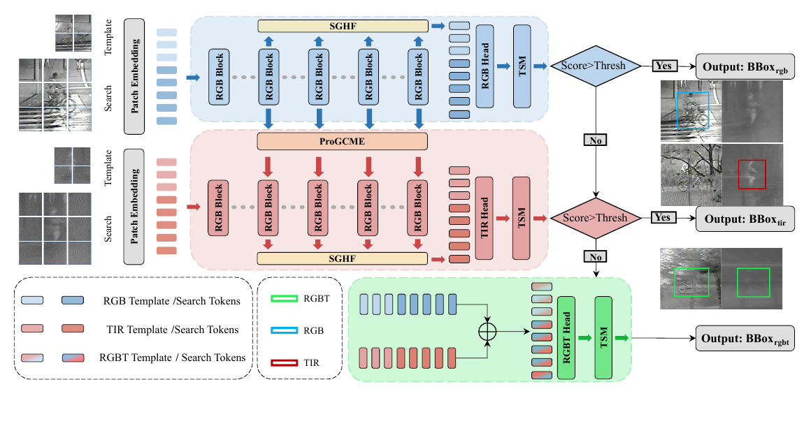

# DMATrack

Code for **Dynamic modality activation for RGB-T tracking with prompt-guided enhancement and hierarchical fusion** ([Pattern Recognition](https://www.sciencedirect.com/science/article/pii/S0031320326020054), [DOI](https://doi.org/10.1016/j.patcog.2026.115041)).



*Overall architecture (Fig. 3 of the paper).*

## Testing

The tested environment is Linux, Python 3.8, PyTorch 1.10.1 with CUDA 11.1, and an NVIDIA GPU. The CUDA development toolkit and GCC/G++ 9 are needed to build PreciseRoIPooling.

Download [LasHeR](https://github.com/BUGPLEASEOUT/LasHeR) and arrange its test split as `LasHeR/testingset/<sequence>/{visible,infrared,init.txt}`. Place the original model checkpoint at `checkpoints/DMATrack_ep0010.pth.tar`, or set `DMATRACK_CHECKPOINT` in `local.env`. 
Alternatively, download the checkpoints from Baidu Netdisk:

- Link: https://pan.baidu.com/s/1UGvsEwjEyJofhxPQy03I4Q?pwd=pd8p
- Extraction code: pd8p

After downloading, place the original checkpoint at `checkpoints/DMATrack_ep0010.pth.tar`, or set `DMATRACK_CHECKPOINT` in `local.env` to the downloaded checkpoint path.

```bash
conda env create -f environment.yml
conda activate dmatrack
cp local.env.example local.env
# Edit local.env: LASHER_ROOT, DMATRACK_CHECKPOINT, GPUS, CUDA_HOME, CC and CXX.
bash scripts/build_ops.sh
bash scripts/smoke_test.sh output/smoke_test
bash scripts/test_7611.sh output/test_7611
```

The full test writes tracking boxes to `output/test_7611/results/*.txt` and summary metrics to `output/test_7611/results/evaluation.json`. Each output directory must be new. To evaluate saved predictions:
The LasHeR result files are also available from Baidu Netdisk:

- File: `DMATrack_LasHeR.zip`
- Link: https://pan.baidu.com/s/1Cyt0zgzhoIJOhjeJ2OthdQ?pwd=wn5d
- Extraction code: wn5d

After downloading and extracting the archive, use the contained result files with the evaluation command below.

```bash
python tracking/evaluate.py --results output/test_7611/results
```

**Testing scope.** `test_7611.sh` tests the original epoch-10 checkpoint with a fixed RGBT inference profile and template updates.

To test a separately trained gate checkpoint with the dynamic routing profile, set `DMATRACK_CHECKPOINT` in `local.env` to that checkpoint and run:

```bash
bash scripts/test_gate.sh output/test_gate
```

## Citation

```bibtex
@article{fan2026dmatrack,
  title={Dynamic modality activation for RGB-T tracking with prompt-guided enhancement and hierarchical fusion},
  author={Fan, Bin and Gao, Feng and Liu, Hongmin},
  journal={Pattern Recognition},
  pages={115041},
  year={2026},
  doi={10.1016/j.patcog.2026.115041}
}
```

